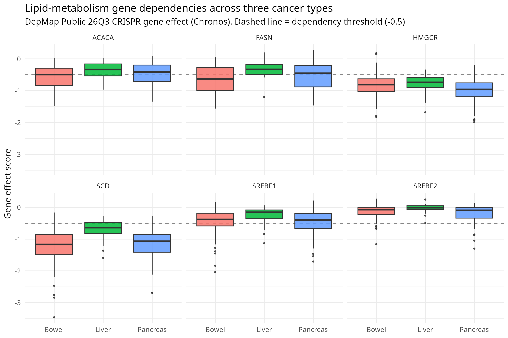
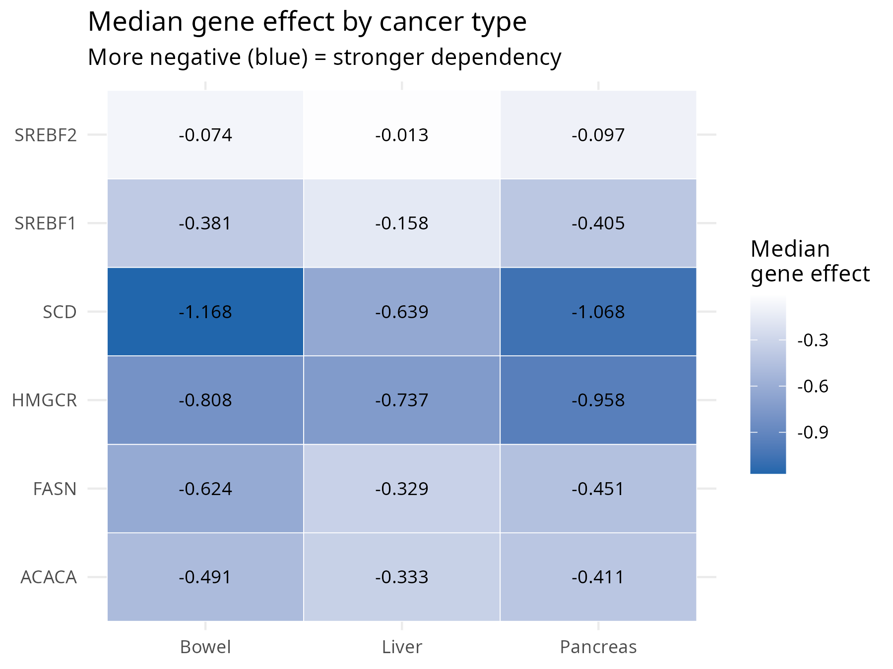

# Lipid-metabolism gene dependencies in liver, colorectal and pancreatic cancer cell lines

A short analysis of public CRISPR screen data, asking whether cancer cell lines from
different tissues differ in how much they depend on fatty-acid and cholesterol
synthesis genes.

## Question

Tumours need lipids to build membranes, and some cancers make their own while others
take them up from the environment. If that differs by tissue, cell lines from
different cancers should differ in how badly they are hurt when a lipid-synthesis
gene is knocked out.

**Do liver, colorectal and pancreatic cancer cell lines differ in their dependency on
lipid-metabolism genes?**

## Data

- **Source:** DepMap Public 26Q3, CRISPR gene effect (Chronos), downloaded through the
  DepMap portal's Custom Downloads tool.
- **Genes:** SCD, FASN, ACACA (fatty-acid synthesis), SREBF1, SREBF2 (transcriptional
  regulators), HMGCR (cholesterol synthesis).
- **Cell lines:** 181 lines across three lineages — 85 bowel, 71 pancreas, 25 liver.

A Chronos gene effect score near 0 means knocking the gene out had little effect. A
score near -1 means the knockout hurt the cells about as much as removing a gene that
every cell needs. Following common practice, a line is called **dependent** on a gene
when its score is below **-0.5**.

## Method

`analysis.R` filters to the three lineages, reshapes to one row per cell line per gene,
and then:

1. Summarises median score and the proportion of dependent lines per gene and lineage.
2. Plots the score distributions (Figure 1) and median scores (Figure 2).
3. Tests whether the three groups differ, using a Kruskal-Wallis test per gene
   (rank-based, so it does not assume normally distributed scores), with
   Benjamini-Hochberg correction for testing six genes.

## Results

Percentage of cell lines dependent (score below -0.5):

| Gene | Liver (n=25) | Bowel (n=85) | Pancreas (n=71) | Adjusted p |
|---|---|---|---|---|
| SCD | 68.0% | 91.8% | 93.0% | 0.0003 |
| HMGCR | 80.0% | 83.5% | 94.4% | 0.0035 |
| FASN | 20.0% | 58.8% | 42.3% | 0.0093 |
| SREBF1 | 20.0% | 40.0% | 38.0% | 0.0130 |
| SREBF2 | 0.0% | 8.2% | 12.7% | 0.0157 |
| ACACA | 28.0% | 48.2% | 40.8% | 0.0277 |

**All six genes differ significantly across the three lineages after correction.**

Three things stand out:

1. **Liver lines are consistently the least dependent.** This holds for every gene
   tested. SCD is the clearest case: a median score of -0.64 in liver against -1.17 in
   bowel and -1.07 in pancreas.
2. **SCD is a near-universal dependency in bowel and pancreas**, with over 90% of lines
   in each dependent on it. SCD introduces a double bond into saturated fatty acids,
   and cells that cannot do this accumulate saturated lipids.
3. **A regulator and its pathway enzyme behave differently.** HMGCR, the rate-limiting
   enzyme of cholesterol synthesis, is a dependency in 80 to 94% of lines, while
   SREBF2, the transcription factor that controls that pathway, is a dependency in
   almost none. Other inputs may keep the pathway running when SREBF2 is lost.

## Limitations

- Cell lines in culture are not tumours. Lipid availability in culture medium differs
  from the tumour microenvironment, which is exactly the setting where lipid dependency
  is likely to matter most.
- The liver group is small (n=25), so its estimates are less precise than the others.
- Each gene is knocked out on its own, so redundancy between pathway members is not
  captured.
- This is an association across lineages, not a test of any mechanism.

## Files

| File | Contents |
|---|---|
| `analysis.R` | Full analysis |
| `results_summary.csv` | Per-gene, per-lineage summary |
| `results_tests.csv` | Kruskal-Wallis results |
| `fig1_boxplots.png` | Score distributions |
| `fig2_heatmap.png` | Median scores |

## Reproducing

Download the six genes from DepMap Custom Downloads (CRISPR Chronos dataset, with cell
line metadata), put the CSV in this folder, and run `analysis.R`. Requires R and
`tidyverse`.

## Citation

DepMap, Broad (2026): DepMap Public 26Q3. https://depmap.org/portal/
